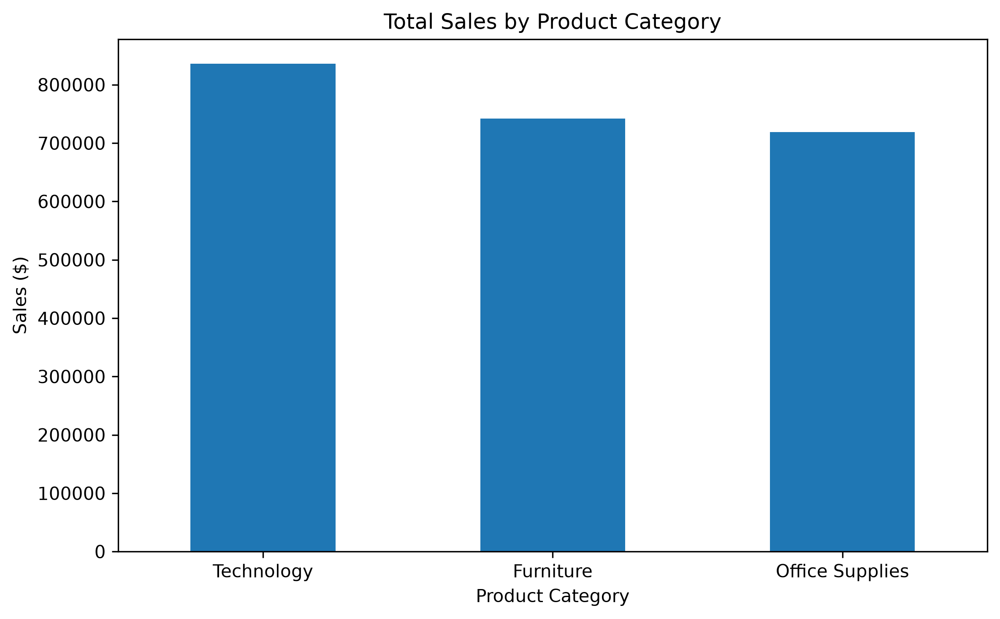
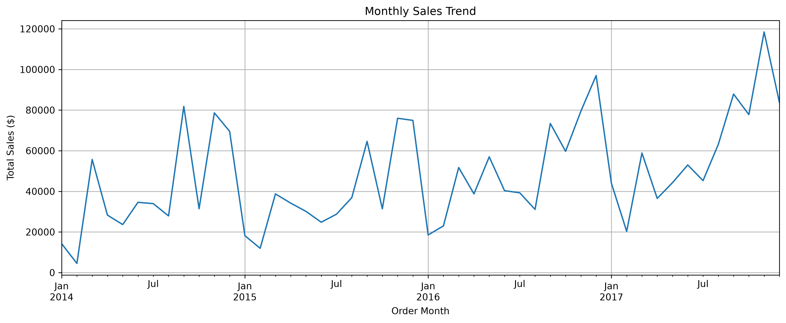
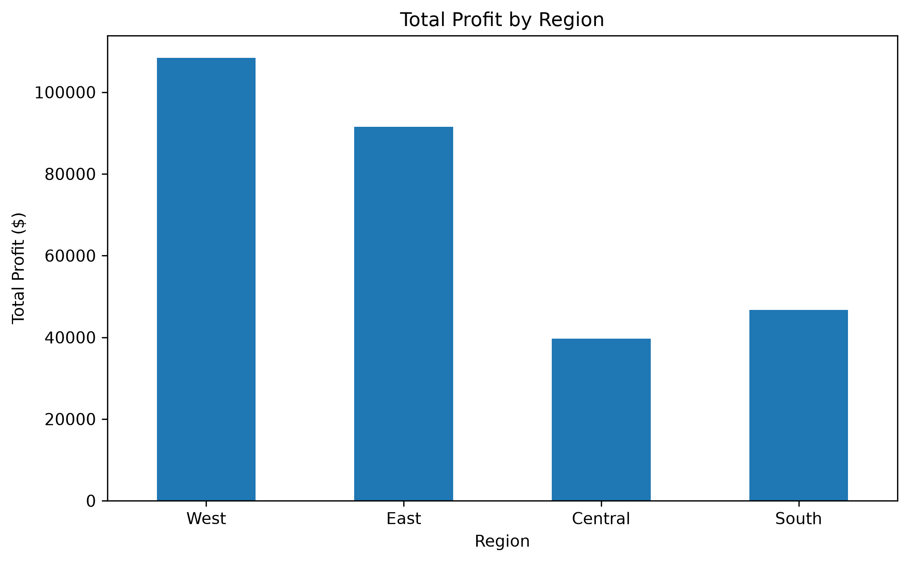
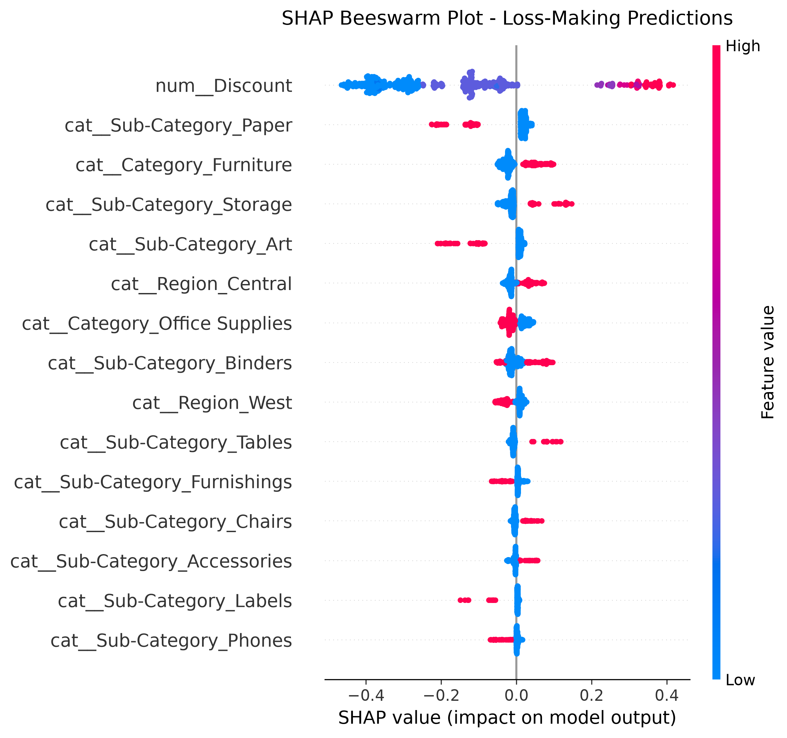
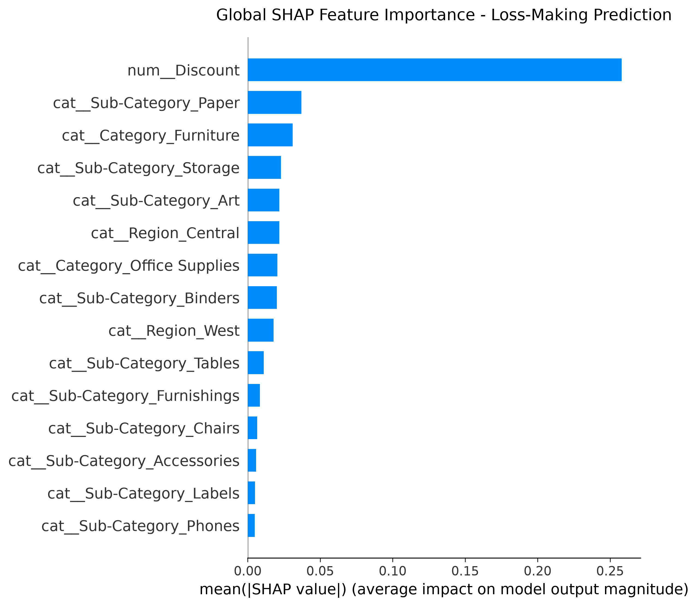

# E-Commerce Sales & Profitability Analysis

## Project Overview
This project analyzes the Superstore retail dataset to identify sales trends, profitability patterns, product performance, and regional business opportunities.

## Business Objectives
- Analyze overall sales and profit.
- Identify top-performing products and categories.
- Evaluate regional sales performance.
- Analyze customer segments.
- Identify products with low profitability.
- Provide data-driven business recommendations.

## Tools & Technologies
- Python (Pandas, NumPy, Matplotlib)
- SQL
- Microsoft Excel
- Microsoft Power BI
- Git & GitHub

## Project Workflow
1. Data Acquisition
2. Data Cleaning
3. Exploratory Data Analysis
4. SQL Business Analysis
5. Excel Analysis
6. Power BI Dashboard
7. Business Insights & Recommendations

## Dataset
Superstore retail sales dataset.

## Project Status
In Progress

## Author
Data Analyst Portfolio Project

## 📊 Project Visualizations

### 1. Category Sales and Profit Analysis

### 2. Monthly Sales Trend

### 3. Regional Profitability

### 4. SHAP Beeswarm Analysis

### 5. SHAP Global Feature Importance
